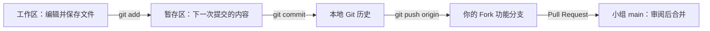

# 李宗蔚：从 Fork 到 PR 的逐步操作手册

核对日期：2026-11-03。面向第一次独立贡献代码的成员。先阅读本文件，再读 [C 模块代码与原理](C_MODEL_RELIABILITY_ZH.md)、[每个文件的作用](C_FILE_MAP_ZH.md) 和 [论文精读路线](C_PAPER_READING_ZH.md)。

## 1. 先认清你的任务和现在的位置

图片 1 的 A–F 是论文方向的推荐编号；图片 2 和《261103se分工建议.pdf》的 A–F 是项目开发分工。你目前的开发角色是 **C：模型与可靠性**，论文兴趣是企业流水线与基建。两者可以同时成立。

你的工作是把“不可靠的模型返回值”变成“有来源、有覆盖状态、资源受控的审查结果”：双模式、Finding、证据、超时、有限重试和运行记录。A 管公共契约与流水线，B 管上下文，D 管门禁，E 管报告，F 管评测。你需要写自己模块的测试。

当前实际情况：

| 项目 | 已核对内容 |
| --- | --- |
| 小组上游仓库 | `CS5351-inspector/context-aware-risk-gated-code-review` |
| 你的 Fork | `FubieLee/context-aware-risk-gated-code-review` |
| 已有功能分支 | `feat/validate-review-responses` |
| 已有草稿 PR | [PR #2](https://github.com/CS5351-inspector/context-aware-risk-gated-code-review/pull/2) |
| 本地代码 | `F:\个人培养方案\个人资料\港城\CS5351-code-review-workshop\repository` |
| 本轮开始时你的提交 | `64975218ff6bdbb3a3cb8f4710047a37b30a0fde` |
| 本轮核对的上游 main | `fad72c5`，完整值用下文 `git rev-parse` 查询 |
| 小组文档 | 主仓库内的 `docs/TODO.md`、`docs/TECH_SPEC.md`，文件名是大写 |

你已有 Fork、分支、PR，**日常继续开发直接从第 4 节开始**。第 3 节是以后从零操作时用的，不要对现有目录重复 clone 或重复建同名分支。

## 2. 必须懂的 12 个词

| 词 | 含义 | 在这里的具体例子 |
| --- | --- | --- |
| Git | 保存版本历史的本地工具 | 断网也能 commit |
| GitHub | 托管远端 Git 仓库、PR 和自动化的平台 | 浏览器里的小组仓库 |
| repository / repo | 仓库，包含受版本控制的文件与历史 | 小组项目 |
| Fork | GitHub 上你账号下的独立仓库副本 | `FubieLee/...` |
| clone | 将远端仓库和 Git 历史复制到本地 | 磁盘中的 `repository` |
| branch | 指向某个 commit 的可移动引用 | `feat/validate-review-responses` |
| commit | 一次有说明的版本快照 | 保存修改后的源码和测试 |
| SHA | Git 对象的标识 | `6497521...`，不是版本流水号 |
| remote | 本地为远端 URL 取的名字 | origin、upstream |
| origin | 通常是自己 clone 的仓库，名字可自定义 | 本项目是你的 Fork |
| upstream | 通常是最初的小组仓库，也只是名字约定 | 本项目是 `CS5351-inspector/...` |
| PR | Pull Request，拉取请求/合并请求 | 请求把你的分支改动合进小组 main |

“Fork 一个分支”严格说是两个动作：先 Fork 仓库，再在自己的仓库里创建功能分支。分支不会再复制一份完整目录；切换分支时，Git 让当前工作目录呈现对应快照。PR 也不是上传压缩包：它展示来源分支与目标分支之间的差异，供人讨论、测试和决定是否合并。

提交的数据流：



`Ctrl+S` 只保存文件，`git add` 只放入暂存区，`git commit` 只保存本地历史，`git push` 才发到 GitHub。push 到自己的功能分支不会自动合进小组 main。

## 3. 从零：只在没有本地仓库时执行

### 3.1 先安装和登录

使用 Git for Windows、Node.js 24 和编辑器（例如 VS Code）。本项目 Action 的运行环境为 Node 24。这里使用 PowerShell；命令前不输入 `$`、`PS>` 等提示符。

```powershell
git --version
node --version
npm.cmd --version
```

逐条说明：`--version` 请求打印版本并退出；`git` 操作仓库；`node` 执行 JavaScript；`npm.cmd` 管理 Node 依赖，在 PowerShell 下可避开某些机器对 `npm.ps1` 的执行策略限制。任一命令提示“无法识别”，先检查安装与 PATH，重新打开终端后再试。

Git 提交作者信息与 GitHub 登录凭据是两件事。进入仓库后，可以仅对此仓库设置作者：

```powershell
git config user.name "填写你的姓名或 GitHub 昵称"
git config user.email "填写你 GitHub 认可的邮箱或 noreply 邮箱"
```

`git config` 写 Git 配置；`user.name/email` 是 commit 作者署名。没有 `--global` 时仅当前仓库生效。请替换引号内文字；不要把示例当真实邮箱提交。push 时由 Git Credential Manager 弹出网页登录，或使用你已经配置的登录方式；不要把 Token 写进仓库或 URL。

### 3.2 在网页 Fork

1. 登录自己的 GitHub，打开小组仓库。
2. 右上角 `Fork` → 选择自己的账号 → `Create fork`。
3. 确认地址栏是自己的账号，页面提示 forked from 小组仓库。

你已经有 `FubieLee/...`，不需要再 Fork。GitHub 官方说明：[Fork 仓库](https://docs.github.com/en/pull-requests/how-tos/work-with-forks/fork-a-repo)。

### 3.3 clone 并配置远端

只在一个新目录中练习以下命令：

```powershell
Set-Location 'F:\个人培养方案\个人资料\港城'
git clone https://github.com/FubieLee/context-aware-risk-gated-code-review.git cs5351-my-new-clone
Set-Location '.\cs5351-my-new-clone'
git remote add upstream https://github.com/CS5351-inspector/context-aware-risk-gated-code-review.git
git remote -v
git fetch upstream
git switch -c feat/my-next-small-feature upstream/main
```

| 命令部分 | 意思与作用 |
| --- | --- |
| `Set-Location '路径'` | PowerShell 切换当前目录；引号保护空格和中文路径 |
| `git clone URL 目录名` | 下载 Git 历史与文件到新目录，自动把该 URL 命名为 origin |
| `git remote add upstream URL` | 新增上游地址别名，不下载代码；重复添加会报 already exists |
| `git remote -v` | `-v` 是 verbose，显示每个远端的读取和推送 URL |
| `git fetch upstream` | 下载上游最新提交与远端分支信息；不改变当前工作区文件 |
| `git switch -c 名字 upstream/main` | `-c` 表示 create，以上游 main 为起点创建并切换到新功能分支 |

`feat/my-next-small-feature` 是**未来新功能**的示例名字。继续 PR #2 应使用现有分支，见下一节。`upstream/main` 是本地记住的上游 main 状态，只有 fetch 后才更新。

## 4. 现在继续你的 PR #2

```powershell
Set-Location 'F:\个人培养方案\个人资料\港城\CS5351-code-review-workshop\repository'
git status --short --branch
git remote -v
git fetch origin
git fetch upstream
git switch feat/validate-review-responses
git log --oneline -5
git rev-parse HEAD
git rev-parse upstream/main
```

| 命令 | 为什么执行；怎么看结果 |
| --- | --- |
| `git status --short --branch` | 简短状态和分支名。`M` 表示修改，`??` 表示未跟踪；空文件列表表示工作区干净 |
| `git remote -v` | 确认 origin 是 FubieLee，upstream 是 CS5351-inspector，避免推错仓库 |
| `git fetch origin` | 更新自己 Fork 的远端状态，不覆盖本地文件 |
| `git fetch upstream` | 获取组员已合入 main 的改动；未合并 PR 不会自动进入 main |
| `git switch ...` | 切换已有分支，没有 `-c`，不会新建 |
| `git log --oneline -5` | 最近 5 次提交；`--oneline` 每条一行，`-5` 限数量 |
| `git rev-parse HEAD` | 当前分支最新 commit 的完整 SHA；HEAD 通常指当前分支 |
| `git rev-parse upstream/main` | 当前本地记录的上游 main SHA |

若工作区有你未完成的修改，不要为了“干净”执行 reset。先查看 `git diff`；需要临时切换时可用 `git stash push -u -m "temporary C work"`，其中 `stash push` 暂存未提交修改，`-u` 包括未跟踪文件，`-m` 备注。回来后 `git stash pop` 恢复并移除该暂存项；若发生冲突先解决。不要对不认识的文件盲目操作。

## 5. 安装依赖、先运行一次测试

在代码根目录执行：

```powershell
npm.cmd ci
npm.cmd test -- --runInBand
npx.cmd tsc --noEmit --incremental false --checkJs false
```

| 命令部分 | 意思 |
| --- | --- |
| `npm ci` | 根据 package-lock.json 重建 node_modules，适合可复现安装；会重建依赖目录，不用于保存自己的源码 |
| `npm test` | 执行 package.json 的 test 脚本，本仓库为 Jest |
| `--` | npm 参数分界；后面的参数交给 Jest |
| `--runInBand` | Jest 在一个进程中依次跑测试，便于 Windows 稳定复现 |
| `npx.cmd tsc` | 运行项目已安装的 TypeScript 编译器；这里不需要安装另一版本 |
| `--noEmit` | 只检查类型，不生成 JavaScript |
| `--incremental false` | 不使用增量缓存，按当前代码重新检查 |
| `--checkJs false` | 本次只检查 TS，避开已知的 CJS 基线类型问题；不等于完整 tsc 已通过 |

先测旧代码的意义：如果一开始就失败，需要知道是环境、历史问题还是自己引入的问题。测试输出 `PASS` 只覆盖已有用例，不能证明模型理解代码的准确率。当前 C 测试全部 mock，不需要模型 Key，也没有调用付费模型。

## 6. 本次新增功能怎样自己验证

先打开 `src/review/model-types.ts`，理解数据，再读 `model-review.ts` 和 `findings.ts`。用以下命令分别检查：

```powershell
npm.cmd test -- --runInBand test/model-review.test.ts
npm.cmd test -- --runInBand test/model-review.test.ts -t "explicit empty reviews"
npm.cmd test -- --runInBand test/model-review.test.ts -t "aborts a hung request"
npm.cmd test -- --runInBand test/model-review.test.ts -t "persistent 429"
npm.cmd test -- --runInBand test/model-review.test.ts -t "partial"
```

第一条跑整个 C 套件；后面 `-t` 是 testNamePattern，只运行名字匹配的用例。Jest 会跳过其他用例，`skipped` 在这种情况下是预期行为。用例名字不区分大小写匹配。

练习方式：找到“保留 temperature=0”的测试，先看断言为什么应为 0，再读实现；尝试在未提交状态临时改坏对应逻辑，运行该测试观察失败，再把自己那一处修改改回。不要对整仓库执行恢复或覆盖命令。能解释测试为什么失败，比只看到绿色更有学习价值。

## 7. 构建：源码为什么还不能直接给 Action 用

```powershell
npm.cmd run build --script-shell='C:/Program Files/Git/bin/bash.exe'
node --check action/index.cjs
git diff --stat
git diff -- src/chat.ts src/review test/model-review.test.ts
```

`npm run build` 执行 package.json 的 build 脚本，先用 Rollup 处理服务端入口，再用 ncc 打包 GitHub Action。原脚本包含 Unix 风格 `rm -rf dist`，因此在 Windows 上明确使用 Git Bash；`--script-shell` 指定 npm 脚本解释器。若 Git 安装在其他路径，替换为你真实的 `bash.exe`。

`node --check` 只检查打包入口的语法，不调用模型。`git diff --stat` 显示修改文件数量和增删行数；`git diff -- 路径...` 只查看指定路径，`--` 表示后面都是路径。新文件未暂存时不会出现在普通 diff 中，先用编辑器查看，暂存后用 `git diff --cached` 检查。

`action.yml` 指向 `action/index.cjs`，所以修改已接入入口的源码后必须重建并提交对应产物。新 C 入口目前供 A 集成，尚未在 bot 中启用；打包生成它的 `.d.ts` 也不表示生产 bot 已调用它。不要把“build 成功”解释为全组项目全部上线。

## 8. add → commit → push：一条条做

完成修改、测试和 build 后执行：

```powershell
git status --short
git add src/chat.ts src/review test/model-review.test.ts docs/C_GITHUB_WORKFLOW_ZH.md docs/C_MODEL_RELIABILITY_ZH.md docs/C_FILE_MAP_ZH.md docs/C_PAPER_READING_ZH.md docs/MODEL_RESPONSE_VALIDATION.md action
git diff --cached --stat
git diff --cached --check
git commit -m "feat: add bounded dual-mode model review and validated findings"
git push -u origin feat/validate-review-responses
```

| 命令 | 原理与作用 |
| --- | --- |
| `git add 文件...` | 把这些文件的当前版本加入暂存区；之后再编辑同一文件还需要重新 add |
| `git diff --cached --stat` | 查看将要提交的内容概况；cached/staged 指暂存区 |
| `git diff --cached --check` | 检查冲突标记和空白错误；不是逻辑测试 |
| `git commit -m "说明"` | 把暂存区保存成一个本地 commit；`-m` 直接提供提交说明 |
| `git push -u origin 分支` | 把本地分支发送到自己的 Fork；`-u` 建立跟踪关系，以后可直接 git push |

本次已提交后，再执行相同 commit 命令会看到 nothing to commit，这是正常的；有新的真实修改才需要下一次 commit。`git add action` 会包含构建目录的变化，先确认没有额外文件混入。不要用 `git add .` 把学习笔记、凭据或无关课程文件一起带上。

若临时 add 错一个文件，可用 `git restore --staged 文件路径`：仅取消暂存，工作区文件内容保留。`--staged` 的作用与 `git restore 文件路径` 不同，后者会丢弃该文件尚未暂存的编辑，不要混淆。

## 9. 创建 PR，以及为什么这次不需要重新创建

你当前只需要打开 [已有 PR #2](https://github.com/CS5351-inspector/context-aware-risk-gated-code-review/pull/2)。向相同 head 分支 push 后，新 commit 会自动出现在这个 PR 中，不要为了每次更新再开一个 PR。依据：[官方的 Fork PR 更新说明](https://docs.github.com/en/pull-requests/how-tos/commit-changes/committing-changes-to-a-pull-request-branch-created-from-a-fork)。

以后给一个全新功能提 PR 时：

1. push 新功能分支后打开小组仓库 → `Pull requests` → `New pull request`。
2. 点击 `compare across forks`。
3. **base repository** 选择小组仓库；**base branch** 选择 `main`，即你想合入哪里。
4. **head repository** 选择自己的 Fork；**compare branch** 选择自己的功能分支，即改动来自哪里。
5. 先看页面底部 `Files changed`：差异只能包含你这项工作。
6. 填写标题与正文：问题、行为变化、测试、限制、对接方式。
7. 尚未集成时使用 `Create draft pull request`；准备完毕后在页面点 `Ready for review`。
8. 回应审阅意见，在同一分支修改、测试、commit、push，PR 自动更新。
9. 由团队维护者审阅并合并。创建 PR 不等于已经合并。

PR 里：`Conversation` 看说明与讨论；`Commits` 看提交历史；`Checks` 看自动检查；`Files changed` 看具体差异。绿色检查只表示配置的检查通过，空白 checks 不等于通过。Fork PR 的 Actions 可能等待维护者许可，而且不能直接读取小组 Secrets。

官方步骤：[从 Fork 创建 PR](https://docs.github.com/en/pull-requests/how-tos/create-pull-requests/creating-a-pull-request-from-a-fork)。

## 10. 组员更新 main 后，怎样同步

先确保自己的修改已经 commit，或明确 stash 保存。对于已经公开的 PR 分支，入门阶段可以使用 merge，避免改写历史：

```powershell
git fetch upstream
git switch feat/validate-review-responses
git merge upstream/main
npm.cmd test -- --runInBand
npm.cmd run build --script-shell='C:/Program Files/Git/bin/bash.exe'
```

`merge upstream/main` 把最新 main 合入当前功能分支；可能生成 merge commit。测试和 build 确认兼容；如构建产物改变，检查、add、commit 后再 `git push origin feat/validate-review-responses`。不要只 fetch 就以为工作区已包含组员改动。

若团队明确采用视频常见的 rebase 流程，则改用下面这组，**不要同时把两种流程照抄一遍**：

```powershell
git fetch upstream
git switch feat/validate-review-responses
git rebase upstream/main
```

rebase 将你独有的 commit 逐个重放到最新 main 后，得到线性历史；重放会产生新 SHA。如果冲突，编辑文件，把 `<<<<<<<`、`=======`、`>>>>>>>` 三类标记处理为正确的代码，再 `git add 冲突文件`，接着 `git rebase --continue`；这表示继续重放，不是提交另一个普通功能。若决定取消本次变基，`git rebase --abort` 回到变基前状态。

变基成功后重跑测试与 build。已经 push 的历史发生了改变，需要使用带明确旧值的租约推送，例如在变基前记录：

```powershell
git fetch origin
$previousRemoteSha = git rev-parse origin/feat/validate-review-responses
```

`$previousRemoteSha` 是 PowerShell 变量，保存你核对过的远端旧 SHA。完成 rebase 和验证后：

```powershell
git push "--force-with-lease=refs/heads/feat/validate-review-responses:$previousRemoteSha" origin feat/validate-review-responses
```

`--force-with-lease=引用:旧SHA` 只在远端分支仍是你核对过的旧值时允许改写。若别人已经推入新内容，命令会拒绝，应先核对他人的提交。普通 `--force` 缺少这道检查。不要对团队共享 main 做强推。依据：[git-rebase](https://git-scm.com/docs/git-rebase)、[git-push 的租约机制](https://git-scm.com/docs/git-push)。

## 11. 合并以后

GitHub 显示 `Merged` 后，本项工作才进入 main。更新本地 main：

```powershell
git fetch upstream
git switch main
git merge --ff-only upstream/main
git push origin main
```

`--ff-only` 只允许快进移动分支；main 有额外提交时会拒绝，让你先核对，不会自动制造混杂的合并。如果使用 Squash merge，功能分支里的多次提交会在 main 中变成一次新的提交，旧 SHA 不一定是 main 的祖先。不要因为 `git branch -d` 提示未合并就立刻使用 `-D`；可以保留旧分支并为下一任务重新建分支。

## 12. 常见报错按原因处理

| 现象 | 原因与下一步 |
| --- | --- |
| not a git repository | 终端目录不对；先 Set-Location 到有 `.git` 的 repository |
| remote upstream already exists | 已配置过；用 remote -v 核对即可 |
| branch already exists | 已有分支；用 switch，不加 -c |
| nothing to commit | 没有新的暂存修改，或这轮已经提交；先 status |
| non-fast-forward / rejected | 远端含本地没有的 commit；先 fetch 与 log 核对，不能直接强推 |
| npm ci 失败 | 看具体安装错误、Node 版本与锁文件；不要立刻删除 package-lock.json |
| 测试过了但 Action 行为不变 | 检查 action.yml、构建产物、workflow 实际 uses 的版本，以及新入口是否真的被调用 |
| 没有 CI 结果 | 检查 PR 是否草稿、workflow 触发条件与 Fork 权限；空列表不能当绿色通过 |
| 新 C 模块类型与 #3 对不上 | 接口还没冻结；按代码说明做显式适配，不用类型断言硬糊过去 |

## 13. 怎样结合你给的视频学习

视频：[十分钟学会正确的 GitHub 工作流](https://www.bilibili.com/video/BV19e4y1q7JJ/)。本次无法直接读取该页面，返回 HTTP 412；本手册不是视频逐句转录，命令行为用 Git/GitHub 官方资料校核。

边看边做三件事：每出现一条命令，判断它操作的是工作区、暂存区、本地历史还是远端；每出现 origin/main，问它对应谁的仓库；每出现 rebase/force，说明历史为何改变、别人提交怎样得到保护。视频中的 `checkout -b` 与本手册的 `switch -c` 都可创建并切换分支；`master` 和 `main` 必须以实际仓库为准。本仓库目标是 main。

你能独立解释下面五句话，就已掌握这次流程：Fork 与 branch 不是一回事；commit 没有上传；PR 指向一个持续更新的分支；fetch 不等于改工作区；测试和构建通过仍需要真实集成与团队审阅。
